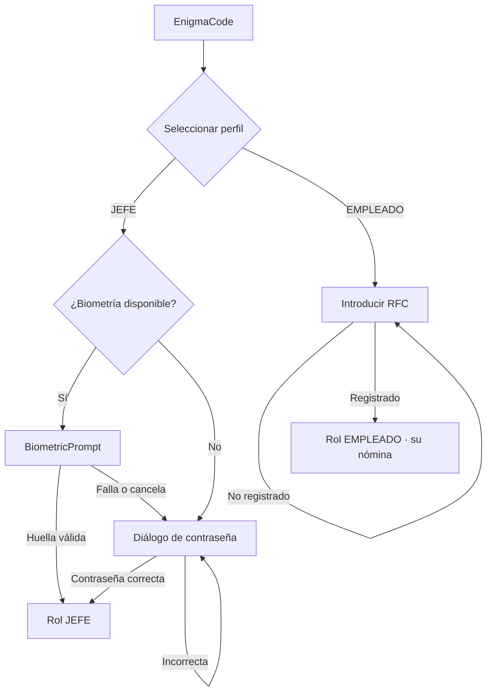

# EnigmaCode 🔐

> App Android de **control de acceso biométrico** y **cálculo de nómina**, desarrollada
> con Kotlin y Jetpack Compose como proyecto de la materia de *Estructura de Datos*
> (4º semestre, ITEI).

[](https://kotlinlang.org)
[](https://developer.android.com)
[](https://developer.android.com/jetpack/compose)
[](LICENSE)

---

## 📱 ¿Qué hace?

**EnigmaCode** controla el acceso a un sistema de nómina con **dos roles**:

| Rol | Cómo entra | Qué puede hacer |
|---|---|---|
| 🧑‍💼 **JEFE** | Huella dactilar (BiometricPrompt) o contraseña de respaldo | Ver, agregar, editar y eliminar empleados |
| 👤 **EMPLEADO** | Su RFC, validado por formato y contra el registro | Consultar únicamente **su propia** nómina |

La app calcula el sueldo final de cada empleado a partir de días trabajados, horas
extra, faltas y la localidad correspondiente, aplicando un bono según el estado.

---

## ✨ Funcionalidades

- 🔐 **Autenticación biométrica** con `BiometricPrompt` (`BIOMETRIC_STRONG`).
- 🔑 **Fallback a contraseña** cuando el dispositivo no tiene lector o la huella falla.
- 🪪 **Validación de RFC** con expresiones regulares (formato persona física / moral).
- 💾 **Persistencia local** con `SharedPreferences` + `Gson` (sin base de datos ni red).
- 🗂️ **CRUD completo** de empleados: crear, buscar, actualizar y eliminar.
- 🔎 **Búsqueda** por RFC (exacta) y por nombre (parcial, insensible a mayúsculas).
- 📊 **Ordenamiento** por sueldo final y por localidad (burbuja, algorítmico).
- 🧾 **Cálculo de nómina**: percepciones, deducciones y bono por localidad.
- 🎨 **UI 100% Jetpack Compose** con Material 3, temas claro/oscuro y tipografía propia.
- 👥 **Roles**: el empleado solo ve su propio registro.

---

## 🧮 Modelo de cálculo

```
sueldoBase      = díasTrabajados × 200
sueldoNeto      = sueldoBase + bono(localidad)
percepciones    = sueldoNeto × 0.20  +  horasExtra × 50
deducciones     = sueldoNeto × 0.22  +  faltas × 200
sueldoFinal     = sueldoNeto + percepciones − deducciones
```

Los bonos por localidad viven en el `enum class Localidad`
(`Yucatán 40 %`, `Puebla 30 %`, `Veracruz 20 %`, `Chiapas 10 %`, `Campeche +$400`).

---

## 🧭 Flujo de acceso



---

## 🛠️ Stack

- **Kotlin** + **Coroutines**
- **Jetpack Compose** (Material 3)
- **AndroidX Biometric** (`androidx.biometric:biometric`)
- **Gson** para serialización
- **SharedPreferences** para persistencia local
- **KSP** + **Room** (declarado en dependencias para la capa de datos futura)
- **Gradle Kotlin DSL**

---

## 🚀 Cómo compilar y ejecutar

**Requisitos:** Android Studio (Ladybug o superior), JDK 17, Android SDK 36.

```bash
# 1. Clona el repositorio
git clone https://github.com/urreadiego0518-code/enigma-code.git
cd enigma-code

# 2. Abre en Android Studio y espera a que Gradle sincronice
#    (o desde la terminal:)
./gradlew assembleDebug

# 3. Instala en un dispositivo o emulador (API 24+)
./gradlew installDebug
```

> Para probar la **ruta biométrica** necesitas un dispositivo o emulador con sensor
> de huella y al menos una huella registrada. Si no hay hardware biométrico, la app
> cae automáticamente al diálogo de contraseña.

---

## 📁 Estructura

```
enigma-code/
├── app/
│   ├── build.gradle.kts          # Dependencias y configuración del módulo
│   └── src/main/
│       ├── AndroidManifest.xml    # Permiso USE_BIOMETRIC
│       ├── java/com/urreadiego/enigmacode/
│       │   ├── MainActivity.kt        # UI Compose, autenticación y navegación por rol
│       │   ├── EmpleadoDatabase.kt     # Estructuras CRUD y ordenamiento
│       │   ├── LocalidadYEmpleado.kt   # Modelo de datos (Empleado, Localidad)
│       │   ├── Constantes.kt           # Constantes de configuración
│       │   └── ui/theme/               # Colores, tipografía y tema
│       └── res/                       # Recursos e íconos
├── gradle/libs.versions.toml     # Versiones centralizadas (Version Catalog)
├── build.gradle.kts
└── settings.gradle.kts
```

---

## 📚 Contexto académico

Proyecto de la asignatura **Estructura de Datos** del 4º semestre del
*Instituto Tecnológico de Tuxtla Gutiérrez*, donde se aplica la *manipulación de
listas, la implementación manual de algoritmos de ordenamiento y el modelado de datos
orientado a objetos* a un caso real: el cálculo de nómina de una empresa.

---

## 📄 Licencia

MIT — úsalo, modifícalo y compártelo. Ver [LICENSE](LICENSE).

---

<div align="center">
  <sub>Hecho por <a href="https://github.com/urreadiego0518-code">Diego Urrea Albores</a> con ☕ y Kotlin</sub>
</div>
